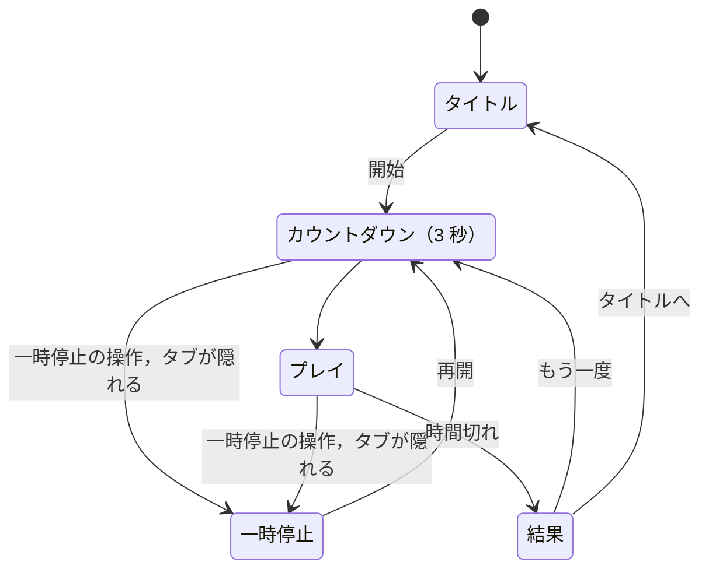
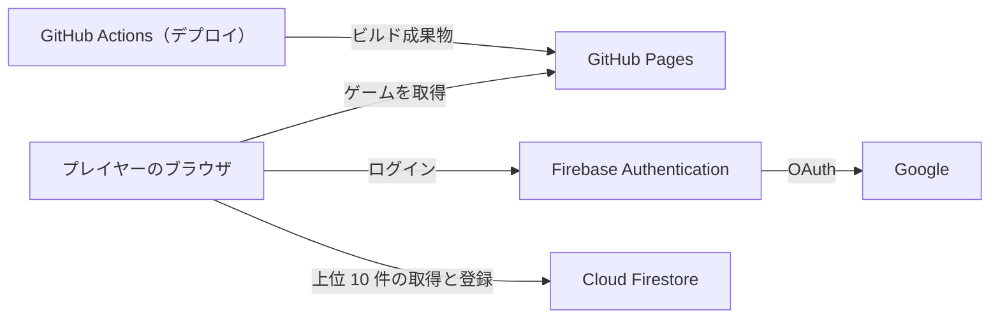

# 🍷 乾杯条例ガーディアン 要求要件書

## 📝 要約

本書は，富良野市の乾杯条例を題材にしたネタゲームの要求要件をまとめる．
スマートフォンと PC のブラウザで遊べ，GitHub Pages で公開する．
ふらのワインとふらのぶどう果汁以外を持つ参加者に雪玉を当てて退場させる．
全員が適合飲料を持つ間は，乾杯ボタンの長押しで得点を伸ばす．

得点は SNS に URL 付きで共有できる．
Google でログインすると，上位 10 件のランキングに登録できる．
ランキングは Firebase に保存し，ゲームの更新とは切り離す．
未決事項の方針は 2026-11-25 にすべて決めた．結果は「未決事項」の章にまとめた．
ただし，11 位以下を即時に削除する方式は M5 の着手時に決める．

## 📋 目次

- 背景と目的
- 題材の確認（条例）
- 対象環境と公開形態
- ゲーム仕様
- 得点計算仕様
- 画面・操作仕様
- 背景・キャラクターの表現
- SNS 共有
- ランキング
- 非機能要件
- 開発の進め方
- 利用者が手作業で行う設定
- 未決事項
- Claude Code への依頼文
- 参考資料

## 🎯 背景と目的

富良野市には「富良野市まずはふらのワインで乾杯条例」がある．
この条例を題材に，冬の室内懇親会で乾杯を守るネタゲームを作る．
会場は TechRAMEN 2026 Conference と同じく，コンシェルジュ フラノ 1 階の広間を模す．

目的は次の 3 点である．

- スマートフォンと PC のブラウザで手軽に遊べること
- 得点を SNS で共有し，ゲームと条例を知ってもらうこと
- 簡単なログインでランキングに参加できること

## 📜 題材の確認（条例）

表 1 は条例の概要である．例規集の原文で確認した．

表 1. 富良野市まずはふらのワインで乾杯条例の概要．

| 項目 | 内容 |
|---|---|
| 正式名称 | 富良野市まずはふらのワインで乾杯条例 |
| 番号 | 平成 25 年 12 月 13 日条例第 29 号 |
| 施行 | 公布の日から施行 |
| 対象 | ふらのワイン及びふらのぶどう果汁（条文上「ワイン等」） |
| 性格 | 市・事業者・市民の努力義務を定める．罰則はない |

第 1 条（目的）の原文は次のとおりである．

> この条例は，本市の特産品であるふらのワイン及びふらのぶどう果汁（以下「ワイン等」という．）による乾杯の習慣を広めることにより，ワイン等の普及の促進を図ることを目的とする．

ゲームでは次のように扱う．

- 適合飲料は「ふらのワイン」と「ふらのぶどう果汁」とする
- ゲーム内のワインはすべて「ふらのワイン」とみなす
- 他産地のワインは登場させない
- 表記は条文に合わせ「ふらのワイン」「ふらのぶどう果汁」とする
- 会場名の表記は公式に合わせ「コンシェルジュ フラノ」とする

実際の条例は努力義務であり，罰則はない．
雪玉で退場させるルールは誇張表現である．
この点を画面と README に注記する（「背景・キャラクターの表現」の章を参照）．

## 🌐 対象環境と公開形態

- 公開先は GitHub Pages とし，リポジトリはパブリックとする
- リポジトリは `tomio2480/furano-wine-toast-ordinance-compliance-game` とする
- 対象ブラウザは iOS Safari，Android Chrome，PC の主要ブラウザとする
- 各ブラウザの最新版と 1 つ前の版で動作させる
- 縦長のスマートフォン画面を優先する（最小 360 × 640 CSS px）
- PC ではゲーム領域を中央に置き，余白は背景色で埋める
- ゲーム本体は静的ファイルだけで動かす
- 外部サービスはランキング用の Firebase だけとする
- ログインなしで遊べるようにする．ログインはランキング登録時だけ求める

公開 URL は次のとおりとする．

```text
https://tomio2480.github.io/furano-wine-toast-ordinance-compliance-game/
```

## 🎮 ゲーム仕様

### 🔹 基本ルール

- 制限時間内に得点を稼ぐ．制限時間は 60 秒とする
- 参加者は画面のランダムな位置に現れ，一定時間で退場する
- 参加者は飲み物を 1 つ持つ
- 不適合飲料の参加者に雪玉を当てると退場し，076 点を得る
- 全員が適合飲料のとき，乾杯ボタンを長押しすると加点される
- 長押し中に不適合者がいると減点される

### 🔹 参加者と飲み物

表 2 は飲み物の種類である．
色だけに頼らず，器の形でも区別できるようにする．

表 2. 飲み物の種類と見た目の手がかり．

| 区分 | 飲み物 | 見た目の手がかり |
|---|---|---|
| 適合 | ふらのワイン（赤） | ワイングラス，濃い赤 |
| 適合 | ふらのワイン（白） | ワイングラス，淡い黄 |
| 適合 | ふらのワイン（ロゼ） | ワイングラス，桃色 |
| 適合 | ふらのぶどう果汁 | 小瓶と脚のないグラス，紫，ぶどうの粒の絵 |
| 不適合 | ビール | ジョッキ，白い泡 |
| 不適合 | 日本酒 | 升またはお猪口 |
| 不適合 | ハイボール | 細長いグラス，気泡 |
| 不適合 | ウーロン茶 | ペットボトル，茶色 |
| 不適合 | コーラ | 缶 |
| 不適合 | ホットコーヒー | マグカップ，湯気 |

参加者の出現は次のとおりとする．

- 出現位置は固定の枠（スロット）から選ぶ．例: 奥の列 4 枠，手前の列 3 枠
- 枠は重ならない配置とし，手前の列ほど大きく描く
- 滞在時間は乱数で決める．例: 2.0〜4.0 秒
- 出現間隔，不適合の比率，同時表示の上限は時間とともに難しくする
- 調整値はすべて定数として 1 か所にまとめる

表 3 は難易度の初期値である．値は試遊して調整する前提とする．

表 3. 難易度の初期値（調整前提）．

| 経過時間 | 出現間隔 | 不適合の比率 | 同時表示の上限 |
|---|---|---|---|
| 0〜20 秒 | 0.9〜1.3 秒 | 35 % | 4 人 |
| 20〜40 秒 | 0.7〜1.0 秒 | 45 % | 5 人 |
| 40〜60 秒 | 0.5〜0.8 秒 | 50 % | 6 人 |

### 🔹 雪玉

- 参加者をタップまたはクリックすると，画面下中央から雪玉が飛ぶ
- 命中判定はタップした時点で行う．飛ぶ演出は判定に影響させない
- 重なった位置では，手前に描かれた参加者を優先する
- 当たり判定は，体と飲み物まで含む絵の外形に合わせる．大きさは最小 44 × 44 CSS px とする
- この大きさは，舞台の幅が 200 CSS px 以上なら確保できる．横向きのスマートフォンも多くは満たす
- 奥の列でテーブルに隠れた足もとは，当たり判定から除く
- 命中した参加者は，その時点で「表示中」から外す
- 退場の演出中の参加者は，乾杯の判定に含めない
- 適合者に当てたときは 38 点を減点する
- 何もない場所を押した場合は空振りとし，得点は変えない

適合者への誤射に罰がないと，全員を撃つのが最適になる．
そのため誤射は減点とする．

### 🔹 進行

図 1 は画面の遷移である．



図 1. 画面遷移図．タイトル，カウントダウン，プレイ，一時停止，結果の 5 状態を遷移する．

- 一時停止の操作は，一時停止ボタン，Esc キー，P キーとする
- 一時停止中は残り時間を進めない
- タブが隠れたら，乾杯ボタンの押下を解除したものとして扱う

## 🧮 得点計算仕様

### 🔹 内部表現

得点は整数で持ち，表示も整数とする．小数を使わないため，浮動小数点の誤差は生じない．
時間は秒ではなく ms で扱い，100 で割って切り上げる．
時刻は ms 単位の整数に丸めてから差を取る．
`performance.now()` は小数を返すため，丸めないと 300 ms が 4 単位になりうる．

表 4. 得点の増減．

| 事象 | 得点 |
|---|---|
| 不適合者に命中 | +076 |
| 乾杯の加点 1 単位 | +237 |
| 乾杯の減点 1 単位 | −0167 |
| 適合者に誤射 | −38 |

表 4 の値は元ネタに由来する．
このため 0167 と 076 は，画面と文書で先頭の 0 を付けて書く．
計算では先頭の 0 を除き，167 と 76 として扱う．

### 🔹 乾杯の状態

次の記号で状態を定める．

- H: 乾杯ボタンが押されているか．タッチ，マウス，キーの論理和とする
- S: 表示中の参加者の集合．命中済みと退場演出中は除く

表 5. 乾杯の状態．

| 状態 | 条件 | 1 単位あたり |
|---|---|---|
| 加点 | H であり，S が 1 人以上で全員適合 | +237 点 |
| 減点 | H であり，S に不適合者が 1 人以上 | −0167 点 |
| 中立 | H でない．または S が 0 人 | 0 点 |

### 🔹 区間と切り上げ

同じ状態が続く連続した時間を「区間」と呼ぶ．
区間は次の時点で区切る．

- 押下の開始と終了
- 状態の変化（参加者の出現・退場・命中による変化を含む）
- 時間切れ
- 一時停止

区間ごとの単位数は次の式で求める．

```text
単位数 = ceil(区間の長さ[ms] / 100)   ※ 長さ 0 ms のときは 0
加点区間の得点 = 単位数 × (+237 点)
減点区間の得点 = 単位数 × (−167 点)   ※ 表記は −0167
```

- 0.05 秒や 0.01 秒の区間は 0.1 秒（1 単位）として数える
- 時間は単調増加の時計（`performance.now()` など）を使い，ms 単位で測る
- フレーム数で時間を数えない
- 進行中の区間は，経過時間を切り上げた暫定値を表示する
- 暫定値は，区間が確定したときの値と一致させる

区間ごとに切り上げるため，状態が細かく切り替わると端数が積み重なる．
これはユーザー指定の仕様どおりとして許容する．

テストしやすいよう，次のような純粋関数に切り出す．

```ts
type KanpaiMode = "plus" | "minus" | "neutral";

/** 区間の長さ（ms）から単位数を返す．0 ms なら 0． */
function unitsFor(durationMs: number): number;

/** 区間の得点（整数）を返す． */
function kanpaiDelta(mode: KanpaiMode, durationMs: number): number;
```

### 🔹 計算例（受け入れテスト）

表 6 の例を自動テストの期待値として使う．

表 6. 得点計算の例．

| No | 操作と状況 | 計算 | 結果 |
|---|---|---|---|
| 1 | 全員適合で 1.00 秒長押し | 10 単位 × +237 | +2,370 |
| 2 | 全員適合で 0.25 秒長押し | 3 単位 × +237 | +711 |
| 3 | 全員適合で 0.01 秒長押し | 1 単位 × +237 | +237 |
| 4 | 加点 0.35 秒の後，不適合者が出現し減点 0.12 秒で離す | +948，−334 | +614 |
| 5 | 加点 0.50 秒，減点 0.30 秒，命中，加点 0.21 秒で離す | +1,185，−501，+076，+711 | +1,471 |
| 6 | 誰もいない状態で 1.00 秒長押し | 0 単位 | 0 |
| 7 | 加点区間の 0.18 秒時点で時間切れ | 2 単位 × +237 | +474 |

### 🔹 その他

- マイナスの合計得点も表示する
- 結果画面に内訳を出す．命中数，乾杯の加点，乾杯の減点，誤射の 4 項目とする

## 🖐 画面・操作仕様

### 🔹 画面一覧

表 7. 画面と主な要素．

| 画面 | 主な要素 |
|---|---|
| タイトル | 遊び方，開始ボタン，ランキング上位 10 件，注記，条例原文へのリンク，クレジット |
| プレイ | 残り時間，得点，乾杯ボタン，乾杯の状態表示，一時停止ボタン |
| 結果 | 得点，内訳，称号，共有ボタン，ランキング登録，もう一度 |
| ランキング | 上位 10 件，自分の記録の削除，ログアウト |

- タイトルと結果の画面と OGP 画像は，1990〜2000 年代のウェブサイト風の見た目にする
- 色帯の見出し，立体的なボタン，罫線の表で組む．結果の得点はアクセスカウンター風に示す
- 色はウェブセーフカラーとし，グラデーションは帯に分ける．角は丸めず，影はぼかさない
- タイトルの題字は，ドットの見えるドット絵にする．読み上げには元の文字を使う
- 題字は 1 文字ずつ波打たせ，称号は電光掲示板風の枠で虹色に変える
- 動きは GIF のように 1 コマ 0.1〜0.15 秒で送る．画面を出してから 5 秒以内に止める
- 止まった動きは，マウスを載せるか触れると最初から流す．動きを減らす設定では動かさない
- 点滅や流れる文字は使わない．結果の見出しなど，ロゴでない飾り文字は HTML の文字のまま描く

### 🔹 操作

表 8. 端末ごとの操作．

| 操作 | スマートフォン | PC |
|---|---|---|
| 雪玉を投げる | 参加者をタップ | 参加者をクリック |
| 乾杯する | 乾杯ボタンを長押し | Space キーを長押し，またはボタンをマウスで長押し |

- スマートフォンでは，片方の指で乾杯し，もう片方で投げられるようにする
- 複数の指の入力は Pointer Events で扱う
- PC はマウス 1 つで両方を同時にできないため，Space キーを用意する
- キーボードだけでも遊べるよう，数字キーで枠を選んで雪玉を投げられるようにする
- 乾杯ボタンは `setPointerCapture` を使い，指がずれても押下を続ける
- `pointerup`，`pointercancel`，`blur`，`visibilitychange` で押下を終える
- プレイ領域（キャンバスと乾杯ボタン）では，ダブルタップでの拡大，文字選択，長押しメニュー，スクロールを抑止する
- メニューの画面では，文字の拡大（WCAG 1.4.4）のため，ピンチでの拡大，文字の選択，パネルのスクロールを許す
- 乾杯ボタンは画面下部の親指が届く位置に置く
- 横向きのスマートフォンでは，舞台を挟む左右が空く．上部の帯を左側へ移す．乾杯ボタンは右側へ移す．文字を大きくしても，参加者が隠れないようにするためである
- 押下中は加点か減点かを色と文字の両方で示す
- カウントダウン中の押下は覚えておき，プレイが始まった瞬間に乾杯を始める．カウントダウン中は表示を中立に保つ

### 🔹 フィードバック

- 命中時は雪が散る演出と「+076」を表示する
- 加点中はグラスが触れ合う演出と「+237」を連続表示する
- 減点中は警告表示を出す
- 効果音は初版に含める．音声ファイルは置かず，Web Audio API で合成する
- 効果音は開始操作の後から鳴らす．ミュートは切り替えられるようにする
- 雪玉の当たった音は，壁へ当てたような乾いた「パン」とする．絵で雪玉が届く瞬間に鳴らす．誤射は低い警告音を続け，命中と聞き分けられるようにする

## 🎨 背景・キャラクターの表現

### 🔹 会場の背景

公開写真で見たコンシェルジュ フラノ 1 階のカフェラウンジを参考にする．
厳密に再現する必要はない．表 9 の要素で雰囲気を出す．

表 9. 背景に取り入れる要素．

| 要素 | 表現 |
|---|---|
| 天井 | 打ち放しコンクリート風の灰色 |
| 壁 | 濃い紺色 |
| 構造 | 明るい白木の柱と梁で組んだ門型の木枠 |
| 照明 | 銅色のドーム型ペンダントライトが列で下がる |
| 家具 | 濃い木目の長テーブル，白木の脚，明るい木の肘掛け椅子（丸い緑の座面） |
| 床 | 明るい木目のフローリング |
| 窓 | 大きな窓と白いブラインド．外は雪景色 |
| 季節感 | 窓の外に降雪，室内は暖色の照明 |

- 写真のトレースや転載はしない．オリジナルのイラストとする
- 施設のロゴ，看板，店名は描かない
- 背景は SVG などのベクタで描き，解像度に依存させない
- 参加者は長テーブルの奥と手前に立つ構図とする

### 🔹 キャラクター

- 参加者はオリジナルのイラストとする
- 実在の人物や既存のキャラクターに似せない
- 体型，服装，髪型を組み合わせて多様にする
- 命中時は雪まみれで驚いて退場する表現とし，痛そうな表現は避ける

### 🔹 商標と注記

- ふらのワインの実際のラベルやロゴは再現しない
- ボトルやグラスは汎用の形で描く
- 画面と README に次の注記を載せる

注記の文案は次のとおりである．

```text
非公式のファンゲームです。富良野市、富良野市ぶどう果樹研究所、コンシェルジュ フラノとは関係ありません。
実際の条例は努力義務で、罰則はありません。飲み物は自由に選んでください。
20歳未満の飲酒は法律で禁止されています。ぶどう果汁でも乾杯できます。
雪合戦以外で、雪玉を人にぶつけないでください。
```

- 条例の原文（富良野市の例規集）へのリンクをページ内に置く
- 会場のモチーフ元として TechRAMEN 2026 Conference をクレジットする

条例原文の URL は次のとおりである．

```text
https://en3-jg.d1-law.com/furano/d1w_reiki/H425901010029/H425901010029.html
```

## 📣 SNS 共有

### 🔹 要件

- 結果画面に共有ボタンを置く
- 本文には得点とゲームの URL を必ず含める
- URL は定数で持ち，`location.href` は使わない（不要な文字列の混入を防ぐ）
- 本文は URL とハッシュタグを含めて全角 100 文字程度に収める
- 各 SNS の投稿画面で，利用者が本文を編集してから投稿できる
- リンクの見た目を整えるため，OGP と X 用のカードの meta を設定する
- OGP 画像は 1200 × 630 px の静的画像とする（得点ごとの生成はしない）
- アクセス解析や追跡用のパラメータは付けない

表 10 は共有先と方式である．

表 10. 共有先と方式．

| 共有先 | 方式 | 備考 |
|---|---|---|
| 端末の共有シート | Web Share API（`navigator.share`） | 対応端末のみ表示．LINE などはここから共有する |
| X | `https://x.com/intent/tweet?text=…&url=…` | 全角は 2 文字として数えられる |
| Bluesky | `https://bsky.app/intent/compose?text=…` | 本文と URL を text にまとめる．上限は 300 文字 |
| Threads | `https://www.threads.com/intent/post?text=…&url=…` | |
| コピー | クリップボードに本文と URL を書き込む | 共有先を問わない |

- パラメータは `encodeURIComponent` で符号化する
- 本文の組み立てと文字数の確認は単体テストの対象とする

### 🔹 投稿文

投稿文は SNS で読まれるため，一般的な句読点（、。）とした．
検討した 4 つの文案から，成績報告の文案を採用した．他の文案は git の履歴に残っている．
変数は `{score}`（得点），`{hits}`（命中数），`{kanpaiSec}`（加点中の乾杯秒数），`{url}`（ゲーム URL）である．
`{kanpaiSec}` は加点区間の単位数を 10 で割り，小数第 1 位まで示す．

```text
ワインとぶどう果汁以外は雪玉で退場。命中{hits}人、乾杯{kanpaiSec}秒、合計{score}点でした。
#乾杯条例ガーディアン
{url}
```

ハッシュタグは `#乾杯条例ガーディアン` の 1 つとし，イベントのタグは併記しない．

### 🔹 称号

結果画面には得点に応じた称号を出す．
表 11 は称号の初期値である．閾値は難易度の調整後に確定する．
初期値は，自動の操作で遊んだ得点の試算をもとに，切りのよい値にしたものである．
試算では，反応の速さと誤射の割合を変えた操作で，それぞれ 200 回遊ばせた．
中央値は約 3.2 万点（初心者），約 5.9 万点（中級），約 8.4 万点（熟練），約 10.1 万点（上級）だった．
初心者はボタンを押し続けるとした．中級以上は，不適合者がいる間は離すとした．

表 11. 称号の初期値（調整前提）．

| 得点 | 称号 |
|---|---|
| 0 点未満 | 雪まみれの幹事 |
| 0〜39,999 点 | 乾杯見習い |
| 40,000〜69,999 点 | 乾杯係 |
| 70,000〜99,999 点 | 乾杯奉行 |
| 100,000 点以上 | 名誉乾杯奉行 |

## 🏆 ランキング

### 🔹 基盤の選定

表 12 は候補の比較である．Firebase を採用する．

表 12. ランキング基盤の比較．

| 観点 | Firebase（Authentication + Cloud Firestore） | Supabase（Auth + Postgres） | 自前（Workers など + OAuth） |
|---|---|---|---|
| 費用 | Spark プランで無料．支払い情報は不要 | 無料プランあり | 無料枠あり |
| ログイン | Google と GitHub を標準で扱える | Google と GitHub を標準で扱える | 認証処理の自作が必要 |
| 停止の条件 | 無料枠を超えると当月はその製品が止まる | 7 日間の利用が少ないと一時停止する | 特になし |
| 採否 | 採用 | 不採用．アクセスが少ない時期に止まる | 不採用．自作しない方針 |

Spark プランの Cloud Firestore は，1 日に読み取り 50,000 件まで無料である．
書き込みは 1 日 20,000 件まで無料である．
上位 10 件の表示と自己ベスト登録だけなら十分に収まる．

LINE は Firebase の標準のログイン手段にない．
OpenID Connect での連携が必要で，Identity Platform への切り替えが前提となる．
その場合の無料枠は月 50 人（MAU）である．初版では対象外とする．

### 🔹 ログイン

- ログイン手段は Google だけとする．追加の設定が最も少ないためである
- GitHub は OAuth App の作成と鍵の登録が別に要るため，初版では採らない
- `signInWithPopup()` を使う
- GitHub Pages は Firebase Hosting ではないため，リダイレクト方式は避ける
- SNS アプリ内のブラウザでは，ログインに失敗する場合がある
- アプリ内ブラウザを検出したら，外部ブラウザで開く案内を出す
- Firebase の SDK は，ランキング操作のときに遅延読み込みする
- 表示名は利用者が入力するニックネーム（1〜16 文字）とする
- ログイン先のアカウント名やメールアドレスは保存せず，表示もしない
- ログアウトと，自分の記録の削除をできるようにする

### 🔹 登録の流れ

1. 結果画面で上位 10 件を取得する
2. 得点が 1 点未満か，10 位以内に入らなければ，その旨を表示して終える
3. 入る場合はログインを求める
4. ニックネームを入力して登録する
5. 自己ベストを超えた場合だけ記録を更新する

### 🔹 データ構造

表 13 は初版の案である．11 位以下の削除の方式と合わせて，M5 で見直す．

表 13. `scores` コレクション（1 ユーザー 1 ドキュメント）．

| フィールド | 型 | 内容 |
|---|---|---|
| ドキュメント ID | string | Firebase Authentication の uid |
| `nickname` | string | 1〜16 文字 |
| `score` | number（整数） | 得点（1 以上） |
| `achievedAt` | timestamp | サーバー時刻 |
| `schemaVersion` | number | スキーマの版．初版は 1 |

- 上位 10 件は `score` の降順，同点は `achievedAt` の昇順で並べる
- この並びに必要な複合インデックスを `firestore.indexes.json` で管理する

### 🔹 セキュリティルール

- 読み取りは誰でもできる
- 作成と更新は本人の uid のドキュメントだけに限る
- フィールドは表 13 のものだけを許可する
- `nickname` は文字列で 1〜16 文字とする
- `score` は整数で，1 以上かつ理論上の上限以下とする
- `achievedAt` はサーバー時刻（`request.time`）と一致させる
- 更新は `score` が既存より大きい場合だけ許可する
- 前回の登録から一定時間（例: 10 秒）は更新させない
- 削除は本人だけに許可する
- ルールは Firebase Emulator と `@firebase/rules-unit-testing` でテストする

ブラウザで動くゲームの得点は，完全には改ざんを防げない．
ルールは明らかな不正値を弾くことを目的とし，それ以上はネタゲームとして許容する．
理論上の上限は，命中の最大数と制限時間から求める．

### 🔹 11 位以下の削除

- 保存するのは上位 10 件だけとする
- 登録によって 11 位以下になった記録は，その場で削除する
- 定期実行の削除ジョブは前提としない．Spark プランでは Cloud Functions も使えない
- バックアップは取らない

即時削除では，登録した人の端末が，押し出された他人の記録を消す必要がある．
この点で，表 13 の「1 ユーザー 1 ドキュメント」と，上のルールの「削除は本人だけ」とは両立しない．
このため，表 13 とセキュリティルールは，削除の方式と合わせて M5 の着手時に見直す．
候補は次の 2 つである．

- 上位 10 件を 1 つのドキュメントにまとめ，取引で更新する．ルールは件数の上限と，自分の項目だけの追加・置換を検証する
- 1 ユーザー 1 ドキュメントのまま，11 位以下の記録に限って他人の削除を許す．ルールで順位を確かめる手段が別に要る

上位 10 件にいない Authentication のユーザーは削除しない．
他人のユーザーの削除には Admin SDK を使う定期処理が要り，上の前提に反するためである．

### 🔹 ゲーム更新時のデータ保全

- ランキングは Firestore に保存し，GitHub Pages のデプロイと切り離す
- これにより，ゲームを更新してもランキングは消えない
- デプロイ処理から Firestore を操作しない
- Firestore を書き換えるのは，利用者による登録と削除の操作だけとする
- スキーマの変更は項目の追加だけとし，`schemaVersion` で見分ける
- 既存データを消す移行処理は作らない
- ルールとインデックスはリポジトリで管理し，利用者が CLI でデプロイする
- Firestore の場所（リージョン）は作成後に変えられない．東京（`asia-northeast1`）を推奨する

図 2 はシステム構成である．



図 2. システム構成図．ゲーム本体は GitHub Pages，ランキングは Firebase に置き，両者のデプロイを分ける．

## ⚙ 非機能要件

### 🔹 性能

- 中程度のスマートフォンで 60 fps を目標とする
- Firebase を除く初期表示の転送量は，gzip 後 300 KB 以下を目安とする

### 🔹 アクセシビリティ

- `ACCESSIBILITY.md` で準拠水準を決める．目標は WCAG の最新勧告版のレベル AA とする
- 即時の反応が必要なプレイ画面は，完全な準拠が難しい
- タイトル，結果，ランキング，共有の画面は AA を満たす
- 色だけに頼らず，形と文字でも情報を伝える
- `prefers-reduced-motion` のときは演出を控えめにする
- ボタンには読み上げ用の名前を付ける

### 🔹 セキュリティ

- ニックネームは `textContent` で表示し，HTML として解釈させない
- meta 要素で Content Security Policy を設定する
- 外部から読み込むスクリプトは Firebase だけとする
- Firebase の API キーには HTTP リファラーの制限をかける
- Authentication の承認済みドメインは GitHub Pages のドメインだけにする
- GitHub Actions の外部アクションはコミットの SHA で固定する

### 🔹 プライバシー

- 保存する個人に関わる情報は uid とニックネームだけとする
- アクセス解析は入れない
- 保存する情報と削除方法を簡潔なプライバシーポリシーとして掲載する

## 🛠 開発の進め方

### 🔹 前提

- Claude Code で開発し，`github-dev` と `code-quality` の Skill に従う
- テストファーストの TDD で進める
- Pull Request は Draft で作成し，`git push` は指示を待つ
- 着手前に未決事項と技術構成を利用者に確認する
- 実装計画は GitHub Issue に分解してから着手する

### 🔹 技術構成

技術構成は 2026-11-25 のヒアリングで確定した．
経緯は `docs/notes/2026-11-25-tech-stack-and-complexity.md` に記録した．

- 言語とビルド: TypeScript と Vite．UI フレームワークは使わない
- 描画: プレイ領域は Canvas 2D．ゲームエンジンは使わない
- 画面: メニューと HUD は HTML と CSS で組む
- 単体テスト: Vitest
- E2E テスト: Playwright（スマートフォンのエミュレーションを含む）
- 静的解析: TypeScript の strict 設定と ESLint
- 複雑度: `moznion/cccc` で関数ごとに測る．上限は cognitive と cyclomatic とも 8 とする
- ランキング: Firebase JavaScript SDK（モジュール形式）と Firebase Emulator

複雑度を上げにくくするため，次の設計を守る．

- 分岐は表（`Record`）の参照と配列メソッドへ寄せる
- 画面や乾杯状態の見た目は data 属性と CSS で切り替える
- 純粋関数を小さく保ち，副作用は外側の薄い層へ集める

次の処理は純粋関数として切り出し，先にテストを書く．

- 得点計算（区間，切り上げ，整数の得点）
- 適合判定
- 出現の予定作り（乱数のシードを注入できるようにする）
- 投稿文の組み立てと文字数の確認
- 称号の判定

時計と乱数は外から注入できるようにし，テストで固定できるようにする．

### 🔹 初期セットアップ

- `tomio2480/github-workflows` の Markdown lint の caller workflow を置く
- 同じリポジトリの `session-url-check` の caller workflow を置く
- Dependabot を設定する（`npm` と `github-actions`）
- CodeQL などのセキュリティスキャンを設定する
- `ACCESSIBILITY.md` を作り，axe-core などの自動検査を設定する
- GitHub Pages へは公式の deploy-pages アクションでデプロイする
- デプロイの権限は `pages: write` と `id-token: write` に限る

### 🔹 マイルストーン（案）

表 14. マイルストーンの案．

| No | 名前 | 内容 |
|---|---|---|
| M1 | ゲームの中核 | 得点計算，適合判定，出現，状態遷移．テストを先に書く |
| M2 | 描画と操作 | 背景，参加者，雪玉，乾杯ボタン，複数の指，キーボード |
| M3 | 結果と共有 | 結果画面，内訳，称号，投稿文，OGP |
| M4 | 公開 | Pages へのデプロイ，注記，README |
| M5 | ランキング | ログイン，登録，表示，ルールとそのテスト |
| M6 | 11 位以下の削除 | 登録時の即時削除．方式によっては M5 に含める |
| M7 | 調整 | 難易度，称号の閾値，アクセシビリティの確認 |

M1 から M4 でランキングなしの版を先に公開できる．

## 🙋 利用者が手作業で行う設定

外部サービスの管理画面での作業は，Claude Code では行えない．
表 15 の作業は利用者が行う．Claude Code は手順を案内する．

表 15. 利用者が行う設定．

| No | 作業 | 場所 |
|---|---|---|
| 1 | リポジトリ名とライセンスの決定（済み） | なし |
| 2 | Firebase プロジェクトの作成（Spark）とウェブアプリの登録 | Firebase コンソール |
| 3 | Firestore データベースの作成（本番モード，東京） | Firebase コンソール |
| 4 | Google ログインの有効化 | Firebase コンソール |
| 5 | 承認済みドメインへの GitHub Pages のドメインの追加 | Firebase コンソール |
| 6 | API キーへの HTTP リファラー制限の設定 | Google Cloud コンソール |
| 7 | ルールとインデックスのデプロイ | 手元の Firebase CLI |
| 8 | GitHub Pages の公開元を GitHub Actions に設定 | GitHub のリポジトリ設定 |
| 9 | Dependabot security updates の有効化 | GitHub のリポジトリ設定 |

## ❓ 未決事項

未決事項の方針は 2026-11-25 にすべて決めた．表 16 は決定の一覧である．
No 7 の削除の方式とデータ構造だけは，「11 位以下の削除」の節のとおり M5 で決める．
得点の値は，提案の 0.1 点刻みから利用者の指定した整数に改めた．

表 16. 未決事項と決定．

| No | 項目 | 決定 |
|---|---|---|
| 1 | ゲーム名 | 乾杯条例ガーディアン |
| 2 | 制限時間 | 60 秒 |
| 3 | 適合者への誤射 | 38 点減点．罰がないと全員を撃つのが最適になる |
| 4 | 表示 0 人のときの乾杯 | 加点も減点もしない．乾杯の相手がいないため |
| 5 | マイナスの合計得点 | 表示する．ランキング登録は 1 点以上 |
| 6 | ログイン手段 | Google だけ．追加の設定が最も少ないため |
| 7 | 11 位以下の削除 | 保存は上位 10 件だけ．11 位以下は即時に削除する．方式は M5 で決める |
| 8 | ライセンス | コードと素材の両方を MIT とする |
| 9 | リポジトリ名と公開 URL | 「対象環境と公開形態」の章を参照 |
| 10 | ハッシュタグ | `#乾杯条例ガーディアン` だけ．イベントのタグは併記しない |
| 11 | 投稿文 | 成績報告の文案 |
| 12 | TechRAMEN 2026 の表記 | 会場のモチーフ元としてクレジットする |
| 13 | 効果音 | 初版に含める．ミュートを切り替えられるようにする |
| 14 | 得点の値 | 命中 +076，乾杯の加点 +237，減点 −0167，誤射 −38．表記は先頭の 0 を残し，計算では除く |
| 15 | 条例原文へのリンク | ページ内に置く |

## 🤖 Claude Code への依頼文

次の文を Claude Code に渡す．本書はリポジトリの `docs/requirements.md` に置いている．

```text
docs/requirements.md を読み，この要求要件に沿ってゲームを開発してください．

- github-dev と code-quality の Skill に従ってください（TDD，Draft PR，push は指示を待つ）．
- 着手前に「未決事項」の章と技術構成を私に確認してください．
- 既存の Issue を確認し，実装計画を GitHub Issue に分解してから着手してください．
- 「利用者が手作業で行う設定」の作業が必要になったら，手順を示して私に依頼してください．
- まずは M1 から M4 を進め，ランキングなしの版を公開できる状態にしてください．
```

## 📚 参考資料

- 富良野市の例規集「富良野市まずはふらのワインで乾杯条例」: <https://en3-jg.d1-law.com/furano/d1w_reiki/H425901010029/H425901010029.html>
- 地方自治研究機構「乾杯に関する条例」: <https://www.rilg.or.jp/htdocs/img/reiki/009_kanpai.htm>
- ぐうたび北海道「コンシェルジュ フラノ」: <https://www.gutabi.jp/spot/detail/3300>
- Firebase の料金プラン: <https://firebase.google.com/docs/projects/billing/firebase-pricing-plans>
- Firebase の料金表: <https://firebase.google.com/pricing>
- Firebase の OpenID Connect による認証: <https://firebase.google.com/docs/auth/web/openid-connect>
- signInWithRedirect のベストプラクティス: <https://firebase.google.com/docs/auth/web/redirect-best-practices>
- Supabase のプロジェクト一時停止: <https://supabase.com/docs/guides/platform/project-pausing>
- X の Web Intent: <https://docs.x.com/x-for-websites/post-button/guides/web-intent>
- Bluesky の Action Intent Links: <https://docs.bsky.app/docs/advanced-guides/intent-links>
- Threads の Web Intents: <https://developers.facebook.com/docs/threads/threads-web-intents>
